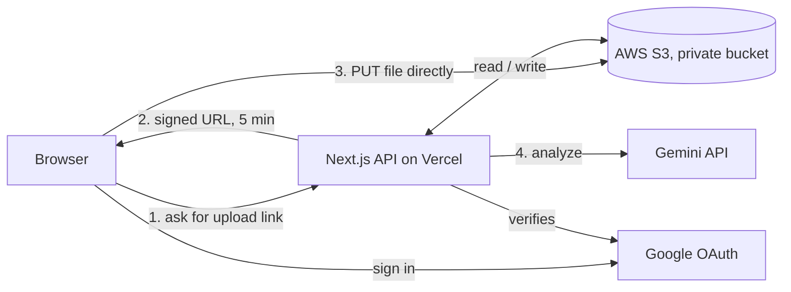

# Lockbox

**A private cloud file manager on AWS S3, with AI-written tags so you can search files by what is inside them.**

Sign in with Google or with an email and password, upload files straight to your own folder in S3, and let Gemini read each file and add tags and a one-line summary. Every user can only ever see their own files.

**Live demo:** https://lockbox-seven.vercel.app


Built with Next.js 16, React 19, TypeScript, Tailwind CSS v4, NextAuth, the AWS SDK v3 and the Gemini API. Deployed on Vercel.

---

## Why I built it

Most file storage searches by file name. Lockbox adds meaning: tags and a summary written from the contents of each file, so "electricity bill" finds the PDF even if it is called `scan_0042.pdf`.

I also wanted a project that touches the real parts of cloud work: S3, IAM, secrets, CORS, OAuth, serverless deployment, logs and security. The engineering decisions below are the point of the project.

## Features

- **Two ways to sign in:** Google, or email and password.
- **Direct-to-S3 uploads** with short-lived presigned URLs. Files never pass through the server.
- **AI tags and summaries** for images, PDFs and text files (Gemini), with a rule-based fallback when AI is unavailable.
- **Ask your vault:** ask a question in plain words and get matching files back.
- **Grid and list views**, image thumbnails, in-page preview for images and PDFs, stars, and multi-select bulk delete.
- **Share links** that expire after 1 hour, 1 day or 7 days.
- **Drag and drop anywhere**, `/` to jump to search, light and dark theme, storage meter by file type.
- **Accessible:** labelled controls, keyboard shortcuts, colours checked for contrast, reduced-motion support.

## How it works



1. The browser asks `/api/upload` for permission. The server checks the session, validates the file, and returns a presigned PUT URL valid for 5 minutes.
2. The browser uploads the file **directly to S3**. The server never handles the file bytes, so uploads are fast and cheap on serverless hosting.
3. `/api/analyze` reads the file from S3, asks Gemini for a summary and tags, and saves them in the user's index file.

### Where data lives

| Data | Location |
| --- | --- |
| Files | `users/<user-id>/<id>__<name>` in S3 |
| Tags, summaries, stars | `users/<user-id>/.index.json` in S3 |
| Email/password accounts | `users/_accounts/<sha256(email)>.json` in S3 |
| Session | Signed JWT cookie |
| Secrets | Server-side environment variables |

There is no database. This keeps the project simple and cheap; see [Limitations](#limitations) for the trade-offs.

## Security design

| Risk | How Lockbox handles it |
| --- | --- |
| One user reading another user's files (IDOR) | The folder comes from the server session, never from the request. Every route checks `ownsKey(user.id, key)` before touching S3. |
| Public bucket leaks | Block Public Access is on. Files are reachable only through expiring signed URLs. |
| Stolen password data | No plain passwords. Salted `scrypt` hashes, compared with a timing-safe function. |
| Guessing passwords | 5 failed tries lock an email for 15 minutes. Sign-ups are limited per IP. |
| Finding which emails exist | A dummy hash runs for unknown emails and the error message is the same. |
| Leaked secrets | Secrets are only read in server files. No `NEXT_PUBLIC_` secrets. `.env.local` is not committed. |
| Over-powerful AWS key | Least-privilege IAM policy limited to one bucket's `users/*` prefix (`iam-policy.json`). |
| Other sites calling the bucket | S3 CORS allows only the app's own origins (`s3-cors.json`). |
| Prompt injection from file contents | The prompt marks file content as untrusted, output must be JSON, and file ids returned by the AI are checked against the user's real list. |
| Abusive uploads | 25 MB limit, file-name checks, 5-minute upload URLs. |

## Tech stack

| Area | Technology |
| --- | --- |
| Framework | Next.js 16 (App Router), React 19, TypeScript |
| Styling | Tailwind CSS v4, CSS variables for theming |
| Authentication | NextAuth v4 (Google OAuth + Credentials, JWT sessions) |
| Storage | AWS S3 via AWS SDK v3, presigned URLs |
| AI | Google Gemini API |
| Hosting | Vercel (serverless functions) |

## Project structure

```
app/
  api/                  Server endpoints (run on the server, can use secrets)
    auth/[...nextauth]  Sign-in and sign-out
    register            Create an email/password account
    upload              Create a presigned upload URL
    files               List the user's files
    download            Create a short-lived open/download URL
    thumbs              Create short-lived image preview URLs
    analyze             AI tags and summary
    ask                 Search by meaning
    share               Create an expiring share link
    star, delete        Star and delete files
  layout.tsx, page.tsx, globals.css
components/             User interface (runs in the browser)
lib/                    Shared server logic
  auth.ts               NextAuth config, getCurrentUser
  accounts.ts           Password accounts, scrypt hashing
  rateLimit.ts          Login and sign-up limits
  s3.ts                 S3 client, ownsKey (ownership check)
  links.ts, files.ts, meta.ts
  analyze.ts, gemini.ts, ask.ts
  client.ts             Browser helpers (API calls, direct upload)
  types.ts, format.ts
iam-policy.json         Least-privilege AWS policy
s3-cors.json            S3 CORS rule
.env.example            Environment variable names
```

## API reference

Every route except `/api/register` and `/api/auth/*` requires a signed-in session and returns `401` otherwise.

| Method | Route | Purpose |
| --- | --- | --- |
| POST | `/api/register` | Create an email/password account |
| GET | `/api/files` | List the signed-in user's files |
| POST | `/api/upload` | Get a presigned upload URL |
| POST | `/api/download` | Get a 5-minute open/download URL |
| POST | `/api/thumbs` | Get 15-minute preview URLs for up to 40 images |
| POST | `/api/analyze` | Generate AI tags and a summary |
| POST | `/api/ask` | Search files by meaning |
| POST | `/api/share` | Create a 1 hour, 1 day or 7 day link |
| POST | `/api/star` | Star or unstar a file |
| DELETE | `/api/delete` | Delete a file |

## Run it locally

You need Node.js 20+, an AWS account, a Google OAuth client, and optionally a Gemini API key.

```bash
git clone <your-repo-url>
cd lockbox
npm install
cp .env.example .env.local     # then fill in the values
npm run dev
```

Open http://localhost:3000.

### Environment variables

| Name | Required | Notes |
| --- | --- | --- |
| `NEXTAUTH_URL` | yes | `http://localhost:3000` locally, your real `https://` address in production, no trailing slash |
| `NEXTAUTH_SECRET` | yes | Generate with `openssl rand -base64 32` |
| `GOOGLE_CLIENT_ID`, `GOOGLE_CLIENT_SECRET` | for Google login | Email/password login works without them |
| `AWS_REGION` | yes | Region of your bucket, for example `ap-southeast-2` |
| `AWS_S3_BUCKET_NAME` | yes | Your bucket name |
| `AWS_ACCESS_KEY_ID`, `AWS_SECRET_ACCESS_KEY` | yes outside AWS | On AWS, use an IAM role instead |
| `GEMINI_API_KEY` | optional | Without it, files get simple type-based tags |
| `GEMINI_MODEL` | optional | Defaults to `gemini-2.5-flash` |

Never commit `.env.local`. Only server code reads these values.

### AWS setup

1. **Create a private S3 bucket** and keep **Block all public access** on.
2. **CORS:** bucket → Permissions → CORS, paste the contents of `s3-cors.json` and replace the origins with your own (`http://localhost:3000` and your deployed address). Without this, browser uploads fail.
3. **IAM:** create a user with the policy in `iam-policy.json` (replace `YOUR-BUCKET-NAME`), create an access key, and put it in `.env.local`.

### Google sign-in setup

Google Cloud Console → APIs & Services → Credentials → Create OAuth client ID (Web application). Add these authorized redirect URIs:

```
http://localhost:3000/api/auth/callback/google
https://YOUR-DOMAIN/api/auth/callback/google
```

## Deploy on Vercel

1. Push the repository to GitHub and import it in Vercel.
2. Add every variable from the table above in **Settings → Environment Variables**. Set `NEXTAUTH_URL` to your live `https://` address.
3. Set the function region next to your bucket (for example `syd1` for `ap-southeast-2`) in **Settings → Functions**.
4. Add your live callback URL in Google Cloud Console and your live origin in the S3 CORS rule.
5. Deploy. Changing a variable needs a new deployment to take effect.

### Troubleshooting

| Symptom | Cause | Fix |
| --- | --- | --- |
| "Server error" on login | A required variable is missing, often `NEXTAUTH_SECRET` | Add it in Vercel and redeploy |
| "This page can't be reached" after login | `NEXTAUTH_URL` still points to localhost | Set it to the live address |
| `redirect_uri_mismatch` | The live callback URL is not registered in Google | Add it to the OAuth client |
| Upload blocked, CORS error in the browser console | The S3 CORS rule does not list the live origin | Add the origin to the bucket CORS |
| "Could not load credentials" | No AWS keys on the server | Add the `AWS_*` variables and redeploy |
| `AccessDenied` or 403 | IAM policy missing or wrong bucket name | Attach `iam-policy.json` with your bucket name |
| Upload gets a 403 despite correct CORS | Signed `ContentLength` mismatch | Remove `ContentLength: fileSize,` in `app/api/upload/route.ts` |

## Limitations

- **Rate limiting is in memory.** On serverless hosting each instance has its own counters, so it slows guessing down but is not a hard guarantee.
- **Accounts and the file index are JSON files in S3.** Simple and cheap, but with no transactions. A larger version would use Cognito or DynamoDB.
- **No email verification or password reset.**
- **Long-lived AWS keys on Vercel.** An IAM role with OIDC would remove them.
- **Share links cannot be revoked** before they expire, which is how presigned URLs work.
- **AI uses a third-party model.** Files over 8 MB get type-based tags instead.

## Roadmap

- [ ] GitHub Actions: lint, type-check, build and deploy on every push
- [ ] Dockerfile (multi-stage) and run on AWS ECS or EC2 with an IAM role
- [ ] Terraform for the S3 bucket, CORS and IAM
- [ ] Cognito or DynamoDB for accounts and the file index
- [ ] Email verification and password reset
- [ ] CloudFront in front of S3, and an SQS queue for AI analysis
- [ ] CloudWatch alerts and an AWS Budget

